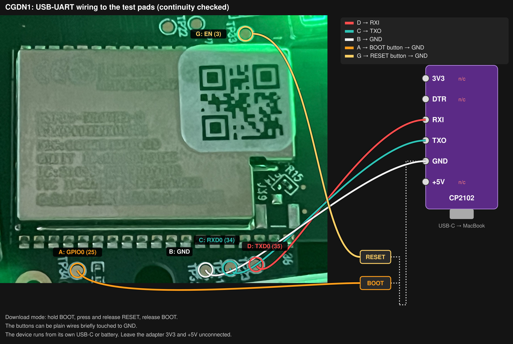
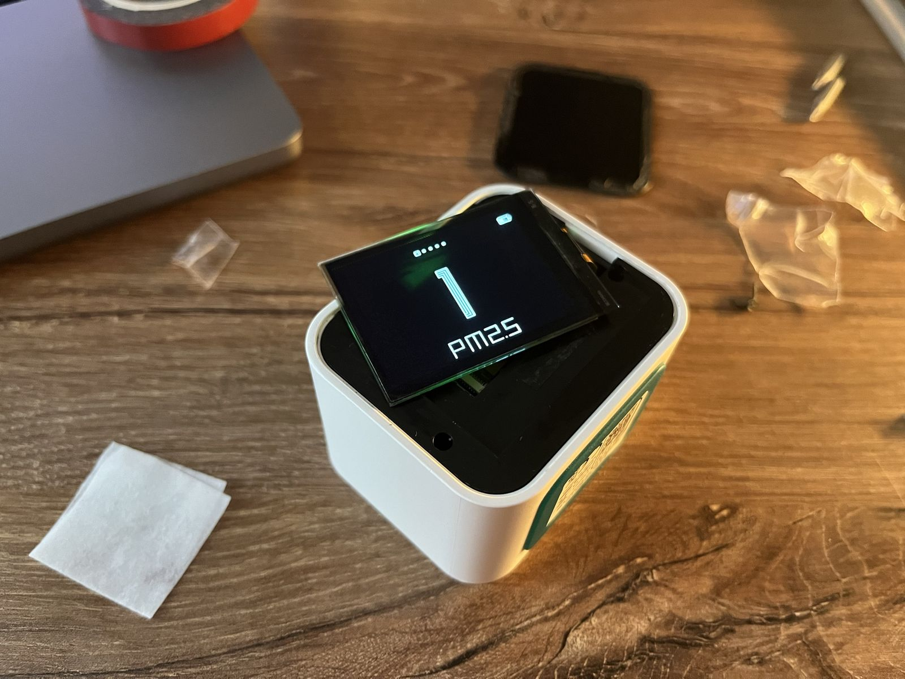
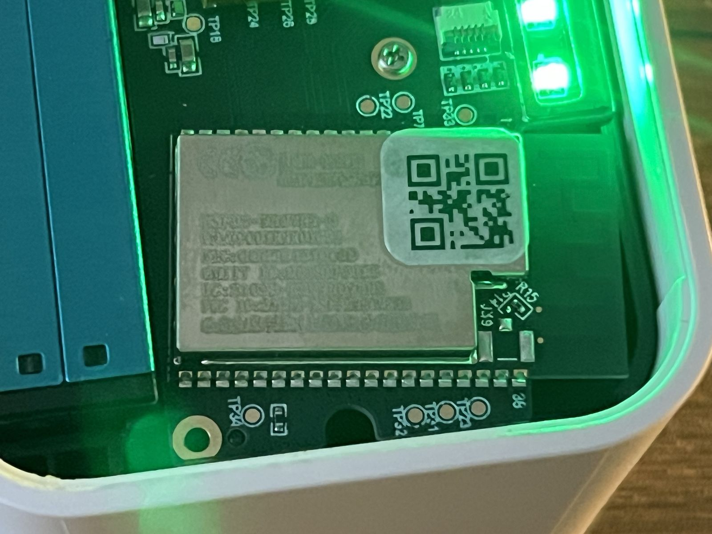

# Hardware

## Board

| Part | Marking | Source |
|---|---|---|
| Wi-Fi/BLE module | ESP32-WROVER-B | Module label on our board; FCC ID 2AC7Z-ESP32WROVERB in the user manual |
| Second MCU | STM32G070CBT6 | [iFixit teardown photo](https://www.ifixit.com/Guide/Disassembling+Qingping+Air+Monitor+Lite+CGDN1/167734), not yet checked on our board |
| SPI NOR flash next to the STM32 | GD25Q80 (1 MB) | Same iFixit photo, not yet checked |
| PM sensor | Plantower PMS7003 | Web search result naming the replacement part, not yet checked |
| CO2 sensor | Sensirion SCD40 | Strings in the stock app image (SCD40_* calls), I2C |
| Touch bar MCU | STM32G070CBT6 | Stock app drives it as the touch controller and can reflash it (ota_mcu) |

The display is driven by the ESP32 over SPI, not by the STM32 (the STM32 is the touch-bar MCU).
Confirmed by disassembly of the stock app image. See the Display and I2C buses sections below.

## ESP32 test pads

Pin numbers follow Figure 1 of the
[ESP32-WROVER-B datasheet](https://documentation.espressif.com/esp32-wrover-b_datasheet_en.pdf).
With the module antenna on the right, the pad row below the module is pins 20…38 from left to
right; the board silkscreen marks 38 next to the rightmost pad.

| Pad | Signal | Module pin | Checked |
|---|---|---|---|
| A (TP34) | GPIO0 | 25 | continuity to pin 25 |
| B | GND | | continuity to the module shield |
| C | RXD0 (GPIO3) | 34 | continuity to pin 34 |
| D | TXD0 (GPIO1) | 35 | continuity to pin 35 |
| G (TP33) | EN | 3 | continuity to pin 3 |
| E, F | unknown | | no continuity to GND |

Letters are ours, see [images/pin-numbers.svg](images/pin-numbers.svg). The silkscreen names of
B, C and D are TP32, TP21 and TP23 in some order; the photo is too blurry to pair them.

In the pad row only pin 38 beeps to the module shield, which matches the datasheet: pins 20…38
contain one GND.

Voltages to GND with the device running on USB power: C (RXD0), A (GPIO0) and G (EN) read 3.3 V;
D (TXD0) reads 0.5 V, 0 V on battery, because the stock firmware does not drive UART0 TX. With A
held to GND and G pulsed to GND, D reads 3.3 V: the ROM bootloader owns UART0 in download mode.

## Wiring

| Pad | USB-UART adapter (CP2102, 3.3 V logic) |
|---|---|
| D, TXD0 | RXI |
| C, RXD0 | TXO |
| B, GND | GND |
| A, GPIO0 | BOOT button to GND |
| G, EN | RESET button to GND |

The adapter's 3V3 and +5V stay unconnected; the device runs from its own USB-C or battery.

Soldering: pad B (GND) sits on the ground plane, which pulls the heat away, so solder does not wet
it at the temperature that works on the other pads. Add flux, raise the iron by 20 to 30 °C (about
340 to 350 °C for leaded solder) and hold it a little longer. The signal pads A, C, D and G tin
easily at 320 °C. The board stays in the housing, and the pads are close to its white plastic edge:
keep the iron shaft clear of it, it melts on contact.

Wires soldered to the pads (continuity to each pin and no shorts between them checked):

| Wire | Pad | Signal |
|---|---|---|
| black | B | GND |
| white | D | TXD0 |
| green | C | RXD0 |
| red, labelled IO0 | A | GPIO0 |
| red, labelled EN | G | EN |

Both red wires carry signals, not power: never connect either to the adapter's 3V3 or +5V.
Swapping the two only breaks the boot sequence; the labels tell them apart.

Download mode: hold BOOT, press and release RESET, release BOOT.

The CP2102 board in use breaks out DTR but not RTS, so esptool cannot reset the chip into the
bootloader by itself; the two buttons do it by hand.

## Display

Monochrome SPI OLED, 160x128, driven by the ESP32. The panel flex is marked NFP1127-02AY, which is
not in any public catalogue; the controller is a mono/grayscale OLED type (SSD1306 / SH1106 / SH1122
command family) but the exact part is not pinned down and is not needed to drive it. All facts below
come from disassembling the stock app image (functions `oled_drive_init`,
`oled_drive_write_init_command`, `oled_drive_refresh_gram`).

Bus: HSPI (SPI2), DMA channel 1, SPI mode 0, MSB first, MISO unused.

| Signal | GPIO |
|---|---|
| MOSI | 4 |
| SCLK | 5 |
| DC | 2 |
| CS | 15 (held low, single device) |
| RST | 22 (active low) |

Clock is 8 MHz when the runtime `lcd_id` is 1, otherwise 2 MHz. `lcd_id` is read from the panel at
boot and logged as `lcd id %d`.

Power-on: configure GPIO 2, 15, 22 as outputs; DC=0, CS=0, RST=0; then an active-low reset pulse on
RST (low about 2 ms, high, low about 5 ms, high about 1 ms); then set up SPI and send the init table.

Init command stream (each byte is a command with DC=0). Two variants selected by `lcd_id`; a shared
`AE` (display off) comes first and a shared `AF` (display on) last:

- `lcd_id == 1`: `AE 20 00 81 D0 AD 00 A0 C8 A8 7F D3 10 D5 07 D9 40 40 40 05 98 00 DB 2B DA C0 A4 A6 ... AF`
- `lcd_id != 1`: `AE 20 81 D0 A0 A6 A9 02 AD 80 C0 D5 F0 D9 13 DB 2B DC 35 30 ... AF`

Driving it so that it does not whine (found on hardware, matches the stock `oled_drive_init`):

- **Hold CS (GPIO15) low permanently** and drive it by hand (`spics_io_num = -1`). With CS toggling
  per byte the controller drops the argument of every two byte command (`81 D0`, `AD 00`, `D5 07`,
  `D9 ..`, `DB 2B`): contrast did nothing, a following value acted as a command and scrolled the
  picture, and the panel's boost converter whined. Held low, the whine dropped noticeably.
- **Order**: reset pulse, init table without the final `AF`, write the whole RAM (all 128 columns,
  including the one the stock refresh skips) while the display is still off, then `AF`.
- The stock never sends contrast, display off or any other command at run time: every
  `oled_drive_write_cmd` call site is in the init tables or the column address setup.
- Orientation after a correct init differs from one made with a broken init; ours is applied when
  the frame is streamed (`s_flip` in `firmware/components/drivers/oled.c`).
- Calibration picture on the device (frame on the outermost RAM pixels, ticks, corner marks): the
  glass shows the whole 160 x 128 RAM, nothing is cropped. The panel sits left of the centre of the
  bezel opening, so there is more bare glass on the right than on the left; software cannot fix that
  without shrinking the picture.
- Upright orientation is `flip = 0` in `firmware/components/drivers/oled.c`, chosen by eye.
- GPIO18 high stops the dust sensor fan; GPIO13 high with GPIO18 low runs it. Left untouched, the
  fan is off. Neither pin changed the panel hum, which came from CS handling (above).
- The residual sound with display and LED on is faint, audible only at the ear.
- `GET /oled?c=..` (raw command bytes), `?reset=1`, `?flip=N`, `?led=0|1`, `?test=1|0` and
  `GET /gpio?pin=13|18&v=0|1` are token gated research probes. They are not in the firmware: a
  test build adds them from the private `cgdn1-dev` repository (firmware/README.md, "Test builds").

Frame: the GRAM is 20 pages of 128 bytes = 2560 bytes = 160 x 128 / 8, packed vertically (one byte
is 8 stacked pixels, SSD1306 style), native layout 128 columns by 160 rows. Each page is written as
a 4-byte command with DC=0, `B0 <page> 00 11` (set page = `page`, column start = 0x10 = 16), then
128 data bytes with DC=1, for pages 0 to 19.

## I2C buses

From the per-port config table read by `platform_i2c_init`:

| Port | SCL | SDA | Note |
|---|---|---|---|
| 0 | GPIO27 | GPIO26 | hardware I2C |
| 1 | GPIO14 | GPIO12 | hardware I2C |
| soft | GPIO15 | GPIO16 | software I2C, not active (SCL 15 is the OLED CS) |

Device map, from an on-device I2C scan (7-bit addresses):

| Port | Pins | Devices |
|---|---|---|
| 0 | SCL 27 / SDA 26 | 0x62 SCD40 (CO2), 0x44 SHT4x (temp/humidity), 0x10 Apple MFi coprocessor |
| 1 | SCL 14 / SDA 12 | 0x0c touch strip / "dany" MCU |

The MFi coprocessor responding at 0x10 means hardware HomeKit is available, not only software HAP.
The touch controller is 0x0c; the stock code's "25" (0x19) is its 8-bit read form (0x0c<<1|1).

## Status RGB LED

Three ledc PWM channels drive the RGB indicator (from the stock RGB_LED init in the dump,
verified on hardware):

| Channel | GPIO |
|---|---|
| R/G/B (order to confirm) | 25, 21, 19 |

GPIO13 and GPIO18 gate a peripheral rail that includes the LED: driving them low turns the LED off.
The stock power-up drives them high. Leave them alone (or high) to keep the LED powered.

## Touch strip

The capacitive touch strip is an I2C slave (the "dany" MCU) at 7-bit address 0x0c on hardware I2C
port 1 (SCL 14 / SDA 12). GPIO32 is the touch line (low while a finger is down). The ESP32 reads
2 bytes with a plain read (no register pointer). The same link carries the MIIO MCU protocol
(version, OTA of the MCU).

Decoded on hardware (reading 0x0c while swiping):

- **byte 0 = finger position** along the strip, about 0x09 at one end to 0xe1 at the other. Idle is
  around 0x8c.
- **byte 1 = status**: bit 0x80 set means a finger is down (0x00 when released); the low nibble is
  the direction the controller detects while moving: 0x08 toward higher byte0, 0x04 toward lower
  byte0, 0x00 for a tap or hold. So the strip reports both position and swipe direction directly.

For paging: on release, read byte1's direction nibble (or byte0 start-vs-end delta); a tap's zone
is byte0 at touch (low = one end, high = the other). Physical left/right maps to the byte0 ends and
can be flipped in software.

## Power button and power management

The stock facts below come from disassembling the stock app image; the one measurement on the
device is marked as such.

The power button input is **GPIO36** (input-only, the SENSOR_VP / RTC pin). The ATtiny814 power MCU
pulls it **low while the button is held** and leaves it high otherwise; nothing has to be sent to the
ATtiny first. Measured on the device (2026-10-23): the raw input register reads GPIO36 = 0 for the
length of each press, 1 at rest.

What the stock firmware does (app image, addresses at run time):

- `0x400edc3c` configures GPIO36 as an input with an any-edge interrupt and starts the "button
  task"; the ISR at `0x40081114` only queues the pin number.
- The task (`0x400edc0c`) waits 50 ms after an edge and reads the button with `0x400edbf4`,
  `gpio_get_level(36) == 0`, so low means pressed.
- Timing (config at `0x3ffc5d04`, set in `0x400e7804`): a release at least 30 ms after the press is a
  click; a press held 2000 ms is a long click, raised while still held by a 1 s software timer
  ("button timer", `0x400f09c0`); 10000 ms raises a further event.
- Click (`0x400e788c`): toggles a "display status" flag that the panel task reads. The "dany" in its
  log lines (`button click -> dany display on/off`) is that flag, not an I2C command: the ESP32 only
  ever reads the ATtiny at 0x0c (the touch bytes, `0x400e26b8`) and never writes to it.
- Long click (`0x400e7990`): drops GPIO13 (the peripheral rail), and when GPIO34 reads high logs
  `long click -> power off` and calls `System_Power_Off` (`0x400e9b10`). On USB it goes to a dark
  "power off charging" state instead (`long chick(in power on chargeing status)`), and a long click
  there powers it on.
- `System_Power_Off`: logs, drives GPIO23 low (`0x400e9514`), then polls GPIO36 every 5 ms
  (`Wait Button Release`) while the rail is still held up by the press.
- Boot (`0x400e9930`): a button held at boot for 100 ms is `button long chick -> power on`, GPIO23
  is raised (`0x400e9524`).
- GPIO34 and GPIO35 are two more inputs, read together into a status byte at `0x400d5034` (low sets
  a bit); by their use, charge state lines.

Our firmware (`drivers/button_press.c`, `main/main.c`): GPIO36 is polled every 50 ms; a press counts
only after the line has been seen released for 500 ms (so the power-on press and a stuck line do
nothing); a release before 2000 ms toggles the screen and the LED, a 2000 ms hold shows "Powering
off", notes `button` as the power-off reason (`off` in `GET /status` after the next boot), drops
GPIO23 and waits for the release (15 s at most). A hold while an update is still unconfirmed is
ignored. On battery the rail goes; on USB it stays, so the board stays dark until the next long
press restarts it.

Charge and power MCU: the **ATtiny814** at I2C port 1, 0x0c (the init logs `Attiny814 IIC Init
Fail`, which is the GPIO32 input setup of the touch path). It powers the board on from a long press
while the ESP32 is off and keeps the rail up while the button is held.

## Noise

A coil-whine "electrical hum" comes from the OLED panel's boost converter when the panel is
powered. Holding RST (GPIO22) low keeps the panel and its boost off and the device is silent. When
the display is actually used the hum returns; the stock init configures the panel DCDC
(0xAD / 0xDB / 0xDC in the init tables) which is where to tune it.

## Disassembly

The step-by-step guide with photos is [install.md](install.md#3-open-the-case).

Follows the [iFixit guide](https://www.ifixit.com/Guide/Disassembling+Qingping+Air+Monitor+Lite+CGDN1/167734).
The display flex cable is on the right edge seen from the front: open the display to the right like a
book. The front glass and the display panel are glued; the panel also in the middle. On our device
the glass was pried up with thin strips of packaging plastic, the panel lifted with a rigid handle
stuck on with double-sided tape, and the glue left on the panel needed an adhesive remover spray.
The ESP32 module is reachable once the display and the plate under it (two screws) are off, without
removing the main board.

The front glass goes back on its old adhesive; new thin double-sided tape is optional.

