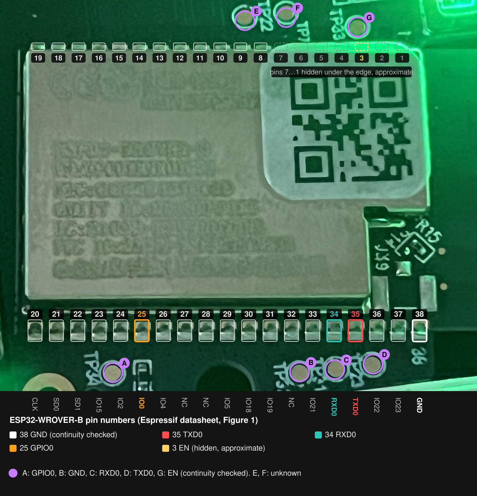

# Installing the firmware

This is how I put the custom firmware on my own Qingping Air Monitor Lite (CGDN1), written down so
you can do the same. The photos are from my device. Each step says what to do, and then, under
"On my device", how it went for me: what I tried, what went wrong and why I ended up doing it this
way. Those notes are not instructions; they are there so you do not repeat my mistakes.

The first install is the only hard part: the device has to be opened and wired to a USB-UART
adapter. After that every update goes over Wi-Fi with the case closed. You will solder five thin
wires to test pads next to the ESP32 module.

> [!CAUTION]
> **Back up the stock firmware before you flash anything (step 7). Without the backup there is no
> way back.** The chip's memory holds things that belong to your device alone and exist nowhere
> else: its HomeKit data (setup code, IDs and keys) and Qingping's own settings. I found them in my
> own backup. This firmware keeps its settings in the same area, so its first start may wipe them
> and a factory reset wipes them for sure. After that the device cannot be added to Apple Home or
> the Qingping app. Writing your backup back is the only fix I know; I have not tried setting
> HomeKit up again from the code on the label. Keep the file to yourself.
>
> The sticker on the side of the case matters too: under its QR code are a HomeKit house icon and
> eight digits, your device's HomeKit setup code. Take a photo of it before you start and keep it
> with the backup, and do not post it anywhere: that is why it is blurred in my photos.
>
> Where exactly, for the curious: `factory_nvs` at 0x3F3000 (namespace `hap_setup`) and `nvs` at
> 0x9000; this firmware's settings start at 0x3D0000.

Contents:

1. [What you need](#1-what-you-need)
2. [Before you open it](#2-before-you-open-it)
3. [Open the case](#3-open-the-case)
4. [Find the pads](#4-find-the-pads)
5. [Solder the wires and connect the adapter](#5-solder-the-wires-and-connect-the-adapter)
6. [Download mode](#6-download-mode)
7. [Back up the stock firmware](#7-back-up-the-stock-firmware)
8. [Build the firmware](#8-build-the-firmware)
9. [Flash it](#9-flash-it)
10. [Connect it to Wi-Fi](#10-connect-it-to-wi-fi)
11. [Close the case](#11-close-the-case)
12. [When something goes wrong](#12-when-something-goes-wrong)

## 1. What you need

Hardware:

- A **USB-UART adapter with 3.3 V logic**. Mine is a CP2102 board with a USB-C socket and the
  pins 3V3, DTR, RXI, TXO, GND and +5V
  ([the one I bought on AliExpress](https://www.aliexpress.com/item/1005007339724808.html); any
  3.3 V CP2102, CH340 or FT232 board does the same job). It needs no driver on macOS.
- A soldering iron, solder and flux.
- Five thin insulated wires, best in five different colours. If some share a colour, tag each with
  its pad.
- A multimeter.
- A small Phillips screwdriver.
- Strong double-sided tape and a small rigid plastic piece to stick on as a handle. Mine was a
  bracket from a window blind.
- Dental floss, the classic kind on a roll.
- An adhesive remover spray and alcohol wipes.
- A thin plastic pry tool for the main board. I used the plastic end of a dental floss pick.

Software, on macOS or Linux:

- [ESP-IDF v5.5.5](https://docs.espressif.com/projects/esp-idf/en/v5.5.5/esp32/get-started/index.html),
  installed with Espressif's guide (into `~/esp/esp-idf`). It brings `esptool.py` 4.12, which the
  backup uses.
- Python 3, `git`, `curl`.
- wasi-sdk 34 for the screen plugins: `plugins/get-wasi-sdk.sh` downloads it.


> **On my device:** I first tried without the adapter: I connected the device to my MacBook with
> a USB-C data cable, and no serial port appeared. Its USB-C port carries power only, so the pads
> are the only way in.

## 2. Before you open it

- **Never connect the adapter's 3V3 or +5V pin to the board.** The device runs from its own USB-C
  cable or its battery. The adapter shares only ground and the two data lines.
- **Power the device from USB-C while flashing.** On battery alone the chip cannot enter download
  mode, and the battery lasted only about half an hour on mine.
- **Back up before you write anything.** See the warning at the top: the dump is the only copy of
  your device's HomeKit setup data and keys. Keep it private.
- **The plastic melts.** The pads sit right by the white housing edge, and I melted it in a few
  places without noticing at the time. Better lift the main board out before you solder (step 3).
  If it stays in, keep the iron's shaft clear of the plastic and watch it all the time: it is easy
  to concentrate on the joint and not see the shaft resting on the edge.
- **Keep the signing key safe.** Your build signs every image with a key you generate (step 8).
  Without that key the device accepts no further update over Wi-Fi, and you have to open it again.
- **Apple Home and the Qingping app stop working.** For now this firmware connects to no smart home
  system. HomeKit support will be looked at later; if that does not work out, there will be an API
  for Home Assistant instead. Restoring the backup should bring the stock features back (end of
  step 12).

## 3. Open the case

The front glass and the display panel under it are both glued.

### The front glass

The better way: stick something rigid you can hold, a piece of plastic for example, to the glass
with good double-sided tape and pull it up gently, a little at a time, the same way as the display
panel below. Classic dental floss pulled under the edge also helps cut the glue.


> **On my device:** I did not think of the handle at first. I cut thin strips from the clear
> plastic packaging that screwdrivers and the like come in. They are thin enough to slide under the
> edge of the glass, and I pried it up gently with them, as in the first photo. Dental floss would
> have helped, but I had only floss picks, not a roll.

### The display panel

The panel's flex cable is on the right edge, seen from the front. The panel is glued around its
edge and in the middle. Stick a rigid handle to it with double-sided tape and lift it gently, so
the panel opens to the right like a book; the flex stays connected.


> **On my device:** the handle in the photos is a plastic bracket from a window blind, stuck to the
> panel with the same double-sided tape. Its short arm works as a lever, and I lifted the panel
> gently with it.

The glue stays on the panel and holds very hard. Soften it with an adhesive remover spray, wipe it
off, then clean the glass with alcohol wipes before you glue anything back.


### The plate under the display

It is held by two screws. Take them out and fold the plate to the right with the panel on it. The
main board with the ESP32 module is under it; the board itself stays in the housing.


The pads can be reached with the main board in place, but I recommend lifting it out before you
solder: in the housing the pads sit right by the plastic edge, which melts (see step 2). Under the
board are the battery and the connectors to the rest of the device.


> **On my device:** I did lift the main board. Its top edge comes up easily, but along the bottom
> it sits on a connector to the board underneath, and that holds it. I levered it off that
> connector gently, a little at a time, with the plastic end of a dental floss pick, which you can
> see in some of the photos.

## 4. Find the pads

The module is an ESP32-WROVER-B. Its pins and the test pads around it are mapped in
[hardware.md](hardware.md#esp32-test-pads); the letters A to G are this project's names for the
pads.



| Pad | Signal | Silkscreen |
|---|---|---|
| A | GPIO0 (IO0) | TP34, next to the gold mounting ring |
| B | GND | one of TP32, TP21, TP23 |
| C | RXD0 | one of TP32, TP21, TP23 |
| D | TXD0 | one of TP32, TP21, TP23 |
| G | EN | TP33 |

B, C and D sit in a row, and I could not read which TP number is which, so find them with a
multimeter: B connects to the module's metal shield, C to module pin 34, D to pin 35.

> **On my device:** nobody had published a pinout, so I found the pads myself with the module's
> datasheet and a multimeter, with the device off. The number printed by the last pad looks like
> "38" or "26" depending on the angle, so I checked with the multimeter instead: of that row only
> pin 38 connects to the shield, and the datasheet says pin 38 is ground.

## 5. Solder the wires and connect the adapter


| Pad | Signal | Adapter pin | Wire in my photos |
|---|---|---|---|
| B | GND | GND | black |
| D | TXD0 | RXI | white |
| C | RXD0 | TXO | green |
| A | GPIO0 (IO0) | not connected: touched to ground by hand | red, labelled IO0 |
| G | EN | not connected: touched to ground by hand | red, labelled EN |

The adapter's 3V3 and +5V stay unconnected.

Soldering tips:

- Pads A, C, D and G take solder easily at about 320 °C.
- Pad B is joined to a large copper area that pulls the heat away. Add flux, raise the iron by 20 to
  30 °C (about 340 to 350 °C for leaded solder) and hold it a little longer.
- Then check with the multimeter that each wire connects to its pin and no two wires touch.


Optional check with the device running on USB power: C, A and G read 3.3 V to ground, and D reads
about 0.5 V.

> **On my device:** I had no wires in different colours, so I took the ones out of an old USB
> cable. That is why two of mine are red. I did not tag them at first, and it cost me a failed
> attempt in step 6.
>
> Pad B would not take solder at the temperature that worked on the others, until I added flux and
> more heat. I soldered with the board still in the housing, and without noticing I melted the white
> plastic next to the pads in a few places with the iron's shaft. Next time I would take the board
> out first.
>
> Pad D showed 0.5 V and I thought the pin was dead or badly soldered. The module's pin itself
> showed the same, so the joint was fine: the stock firmware simply does not use that pin. Step 6
> shows it works.

## 6. Download mode

The adapter has no RTS line, so esptool cannot reset the chip into its bootloader by itself. Do it
by hand, with the device on USB-C power:

1. Hold the IO0 wire against ground (the module's metal shield is ground).
2. Touch the EN wire to ground and take it away.
3. Release IO0 about a second later.

The chip now waits for esptool. To leave download mode, touch EN to ground again with IO0 free.

If the screen stays dark and esptool still cannot connect, the IO0 and EN wires are probably
swapped: EN held on ground keeps the chip in reset.

> **On my device:** the adapter had not arrived yet when the wires were on, so I checked download
> mode with just the multimeter: IO0 twisted to ground, EN tapped to ground, and pad D went from
> 0.5 V to a steady 3.3 V. So the pin works and download mode is not locked on this chip.
>
> The adapter has a single GND pin, and the black wire takes it, so I ground IO0 and EN by pressing
> their ends against the module's metal shield. My first attempt failed: the two red wires were not
> labelled, I twisted EN to ground instead of IO0, and the chip would not start: the screen stayed
> dark. Since then I tell them apart by the pad: the red wire by the gold mounting ring is IO0.

## 7. Back up the stock firmware

Do not skip this step: the backup is the only copy of your device's HomeKit setup data and keys
(see the warning at the top). Make it before anything is written to the flash.

Find the adapter's serial port. On macOS my CP2102 appeared as `/dev/cu.usbserial-0001`; on Linux
look for `/dev/ttyUSB*`. Espressif's
[serial connection guide](https://docs.espressif.com/projects/esp-idf/en/v5.5.5/esp32/get-started/establish-serial-connection.html)
covers the other cases. In a shell with ESP-IDF activated (`. ~/esp/esp-idf/export.sh`), enter
download mode and run:

```bash
esptool.py --port /dev/cu.usbserial-0001 --baud 115200 --before no_reset chip_id
```

If it prints the chip's details, the connection works. Enter download mode again,
then read the whole 4 MB flash:

```bash
esptool.py --port /dev/cu.usbserial-0001 --baud 115200 --before no_reset read_flash 0 0x400000 cgdn1-stock.bin
```

It takes about six and a half minutes at 115200 baud. If any command fails, enter download mode
again and repeat it. esptool checks every block it reads, and the file must be exactly 4194304
bytes:

```bash
ls -l cgdn1-stock.bin
```

Copy the file somewhere safe, off this computer, in two places, and keep it private.

> **On my device:** I first tried a faster speed, 921600, to save time. It broke off halfway, and
> the chip would not answer until I entered download mode again. At 115200 the backup took about six
> minutes and finished.
>
> The chip also reported that nothing on it is locked: no flash encryption, no secure boot. That is
> why Qingping's firmware can be read and replaced at all.

## 8. Build the firmware

```bash
git clone https://github.com/noxend/qingping-cgdn1.git
cd qingping-cgdn1
plugins/get-wasi-sdk.sh          # wasi-sdk into ~/.local, once
. ~/esp/esp-idf/export.sh        # activate ESP-IDF v5.5.5
cd firmware
idf.py secure-generate-signing-key secure_boot_signing_key.pem
idf.py build
```

`secure-generate-signing-key` makes the key every image is signed with; the build refuses to run
without it. The file is in `.gitignore`. Copy it somewhere safe right away: the device takes
updates only from images signed with this key.

Releases published on `cgdn1.swithy.com` are signed with the maintainer's key, so a device built
with your own key does not install them: it still shows them as a new version, and Update fails
when it checks the signature. Leave "Update automatically" off and update with your own builds
(see [Updating](using.md#updating)).

> **On my device:** I keep my key outside the repository folder, in `~/.config/cgdn1/`, so it cannot
> end up in git by accident.

## 9. Flash it

Keep the device on USB-C power, enter download mode (step 6), then from `firmware/`:

```bash
idf.py -p /dev/cu.usbserial-0001 -b 115200 flash monitor
```

This writes everything, the bootloader included. The bootloader never changes over Wi-Fi, and it is
what rolls back a bad update later, so this first flash matters.

When the flash is done, touch EN to ground with IO0 free to restart the chip. `idf.py monitor`
shows the boot log; leave it with `Ctrl+]`.

On the first start the device generates its own setup password and installs the standard screens.
With no Wi-Fi saved, the screen shows a QR code for the setup access point `CGDN1-setup-XXXX`,
with its name under it. Slide on the strip to see the name, the password after `Pass` and the
address `http://10.47.0.1/` as text.


> **On my device:** the first firmware I flashed over the wires did almost nothing on purpose: Wi-Fi
> setup, updates over Wi-Fi and the automatic rollback. I wanted updates to work before anything
> else, so I could close the case and do the rest over Wi-Fi.

## 10. Connect it to Wi-Fi

1. Scan the QR code on the screen with a phone camera and join the network it offers. On a laptop,
   join `CGDN1-setup-XXXX` with the password from the text page. Most phones open the setup page by
   themselves; otherwise open `http://10.47.0.1/`.
2. Choose a device password: 8 to 63 characters, letters, digits or symbols, no spaces. You sign in
   to the web interface with it, and only a factory reset clears it. Write it down.
3. Pick your home network and type its password.
4. Save. The device restarts and joins your network. The page and the device screen show the
   address to open next: `http://cgdn1.local/` and the IP address.

Phones and laptops older than about ten years may not be able to join the setup network.

The rest, the screens, the menu and the web interface, is in [using.md](using.md).

## 11. Close the case

Before you glue the glass back, try one update over Wi-Fi while the wires are still reachable:
build again, then on the System page of the web interface use "Install from file" with
`firmware/build/cgdn1.bin`. The device restarts into it, and if the new version runs fine for a
minute, it stays.

Leave a way back to the pads. One way, shown here: route the wires out through the back grille,
next to the USB-C socket, so the case closes with them still reachable.


Then put the plate back with its two screws, fold the panel back, and press the front glass down:
the old adhesive holds it. New thin double-sided tape is optional.

> **On my device:** I left the wires out through the grille, and it paid off. On 2026-10-20 a new
> build froze about two minutes after start: it did not restart by itself, and a long press of the
> power button did nothing. A tap of EN to ground over those wires brought it back. Without them I
> would have opened the case again.

## 12. When something goes wrong

**esptool cannot connect.** Check, in this order: the device is on USB-C power; TX and RX are
crossed (pad D to the adapter's RXI, pad C to TXO); GND is connected; you entered download mode
right before the command; the baud rate is 115200.

**The screen went dark and stays dark.** The chip is either in download mode or held in reset.
Free IO0 and EN, then touch EN to ground once. If it is still dark, check that EN is not shorted to
ground.

**An update over Wi-Fi does not start properly.** If a new version does not start properly or keeps
crashing, the device goes back to the previous one by itself, and the System page says so.

**The device cannot reach your Wi-Fi.** Its setup access point comes back whenever the home
network is lost. Hold a finger on the touch strip, choose Wi-Fi setup, and the screen shows the
QR code again.

**You forgot the device password.** On the device: hold the touch strip, slide to Factory reset,
hold, slide to "Yes, reset", hold. Settings, Wi-Fi and the password are erased; the firmware stays.
Then set it up again from step 10.

**You lost the signing key.** Generate a new one, build, and flash over the pads again (step 9).
The device then takes only images signed with the new key.

**Back to the stock firmware.** Write the whole backup over the pads, in download mode:

```bash
esptool.py --port /dev/cu.usbserial-0001 --baud 115200 --before no_reset write_flash 0 cgdn1-stock.bin
```

This restores everything the backup holds, the HomeKit data and keys included. I have not tried it
on my device yet, so keep the backup you made in step 7 untouched.
