# Installing the firmware

How to put the custom firmware on a Qingping Air Monitor Lite (CGDN1). The photos are from my
device.

The first install is the only hard part: the device has to be opened and wired to a USB-UART
adapter. After that every update goes over Wi-Fi with the case closed. You will solder four thin
wires to test pads next to the ESP32 module (a fifth is optional).

> [!CAUTION]
> **Back up the stock firmware before you flash anything (step 7). Without the backup there is no
> way back.** The chip's memory holds things that belong to your device alone and exist nowhere
> else: its HomeKit data (setup code, IDs and keys) and Qingping's own settings. Part of them sits
> where this firmware keeps its Wi-Fi network, so its first start may wipe them. After that only
> your own backup brings Apple Home and the Qingping app back. I have written
> mine back and the stock firmware ran again (step 12). Keep the file to yourself.
>
> The sticker on the side of the case matters too: under its QR code are a HomeKit house icon and
> eight digits, your device's HomeKit setup code. Take a photo of it before you start and keep it
> with the backup, and do not post it anywhere: that is why it is blurred in my photos.

Contents:

1. [What you need](#1-what-you-need)
2. [Before you open it](#2-before-you-open-it)
3. [Open the case](#3-open-the-case)
4. [Find the pads](#4-find-the-pads)
5. [Solder the wires and connect the adapter](#5-solder-the-wires-and-connect-the-adapter)
6. [Download mode](#6-download-mode)
7. [Back up the stock firmware](#7-back-up-the-stock-firmware)
8. [Build the firmware](#8-build-the-firmware)
9. [Flash it](#9-flash-it)
10. [Connect it to Wi-Fi](#10-connect-it-to-wi-fi)
11. [Close the case](#11-close-the-case)
12. [When something goes wrong](#12-when-something-goes-wrong)

## 1. What you need

Hardware:

- A **USB-UART adapter with 3.3 V logic**. Mine is a CP2102 board with a USB-C socket and the
  pins 3V3, DTR, RXI, TXO, GND and +5V
  ([the one I bought on AliExpress](https://www.aliexpress.com/item/1005007339724808.html); any
  3.3 V CP2102, CH340 or FT232 board does the same job). It needs no driver on macOS.
- A soldering iron, solder and flux.
- Four thin insulated wires (five if you want the optional EN wire), best in different colours. If
  some share a colour, tag each with its pad.
- A multimeter.
- A small Phillips screwdriver.
- Strong double-sided tape and a small rigid plastic piece to stick on as a handle. Mine was a
  bracket from a window blind.
- Dental floss, the classic kind on a roll.
- An adhesive remover spray and alcohol wipes.
- A thin plastic pry tool for the main board. I used the plastic end of a dental floss pick.

Software, on macOS or Linux:

- [ESP-IDF v5.5.5](https://docs.espressif.com/projects/esp-idf/en/v5.5.5/esp32/get-started/index.html),
  installed with Espressif's guide (into `~/esp/esp-idf`). It brings `esptool.py` 4.12, which the
  backup uses.
- Python 3, `git`, `curl`.
- wasi-sdk 34 for the screen plugins: `plugins/get-wasi-sdk.sh` downloads it.

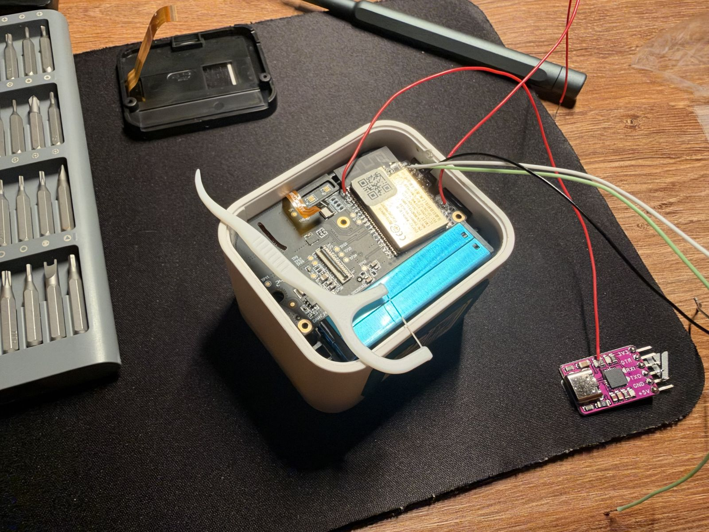

> **On my device:** I first tried without the adapter: I connected the device to my MacBook with
> a USB-C data cable, and no serial port appeared. Its USB-C port carries power only, so the pads
> are the only way in.

## 2. Before you open it

- **Never connect the adapter's 3V3 or +5V pin to the board.** The device runs from its own USB-C
  cable or its battery. The adapter shares only ground and the two data lines.
- **Power the device from USB-C while flashing.** On battery alone the chip cannot enter download
  mode, and the battery lasted only about half an hour on mine.
- **Back up before you write anything.** See the warning at the top: the dump is the only copy of
  your device's HomeKit setup data and keys. Keep it private.
- **The plastic melts.** The pads sit right by the white housing edge, and I melted it in a few
  places without noticing at the time. Better lift the main board out before you solder (step 3).
  If it stays in, keep the iron's shaft clear of the plastic and watch it all the time: it is easy
  to concentrate on the joint and not see the shaft resting on the edge.
- **Keep the signing key safe.** Your build signs every image with a key you generate (step 8).
  Without that key the device accepts no further update over Wi-Fi, and you have to open it again.
- **Apple Home and the Qingping app stop working.** For now this firmware connects to no smart home
  system. HomeKit support will be looked at later; if that does not work out, there will be an API
  for Home Assistant instead. Restoring the backup should bring the stock features back (end of
  step 12).

## 3. Open the case

iFixit has a step-by-step guide with photos:
[Disassembling Qingping Air Monitor Lite CGDN1](https://www.ifixit.com/Guide/Disassembling+Qingping+Air+Monitor+Lite+CGDN1/167734).

The front glass and the display panel under it are both glued.

### The front glass

The better way: stick something rigid you can hold, a piece of plastic for example, to the glass
with good double-sided tape and pull it up gently, a little at a time, the same way as the display
panel below. Classic dental floss pulled under the edge also helps cut the glue.

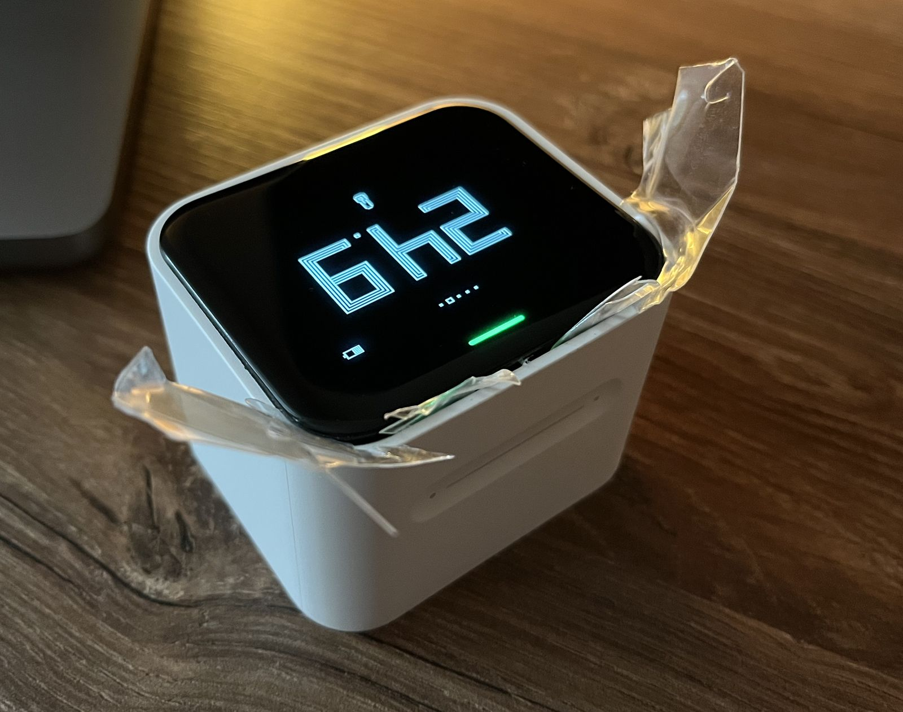

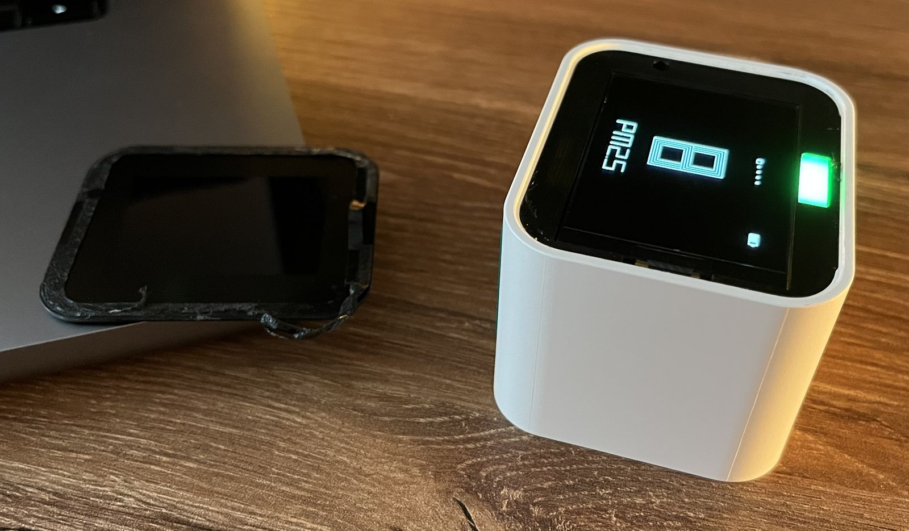

> **On my device:** I did not think of the handle at first. I cut thin strips from the clear
> plastic packaging that screwdrivers and the like come in. They are thin enough to slide under the
> edge of the glass, and I pried it up gently with them, as in the first photo. Dental floss would
> have helped, but I had only floss picks, not a roll.

### The display panel

The panel's flex cable is on the right edge, seen from the front. The panel is glued around its
edge and in the middle. Stick a rigid handle to it with double-sided tape and lift it gently, so
the panel opens to the right like a book; the flex stays connected.

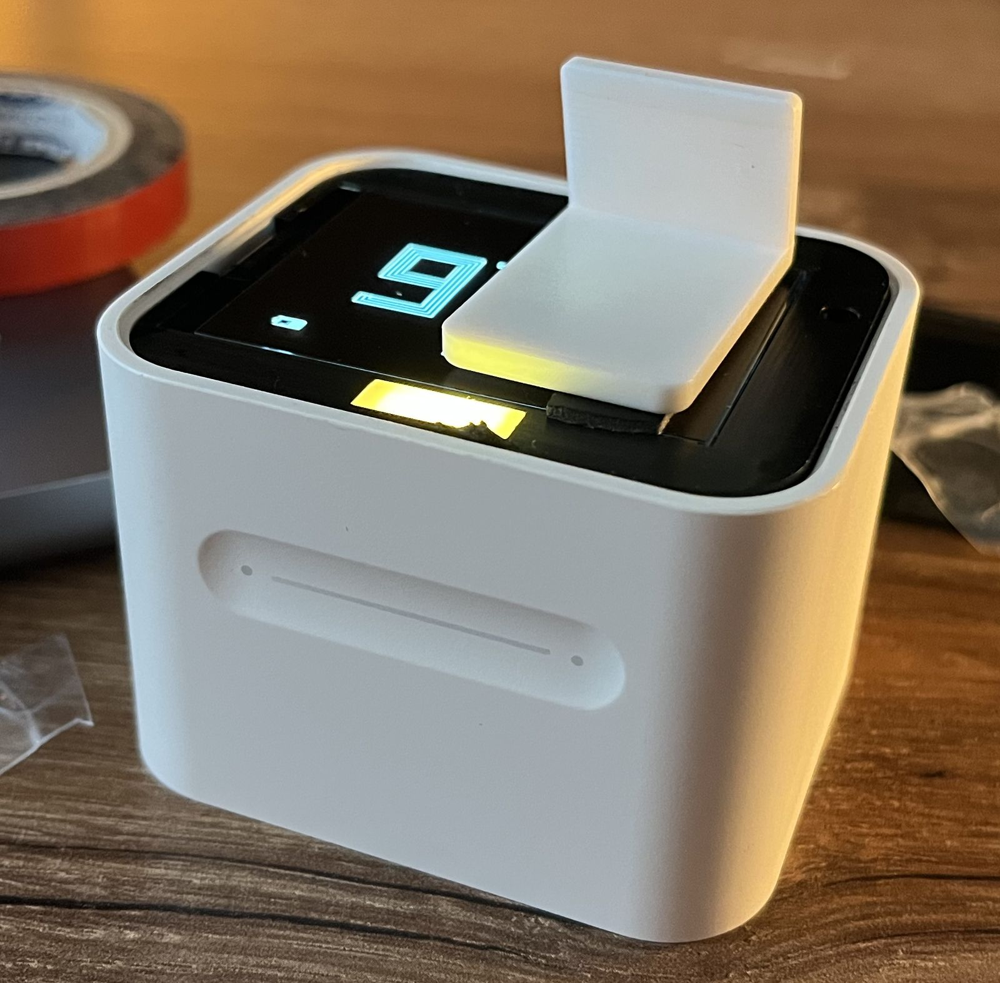

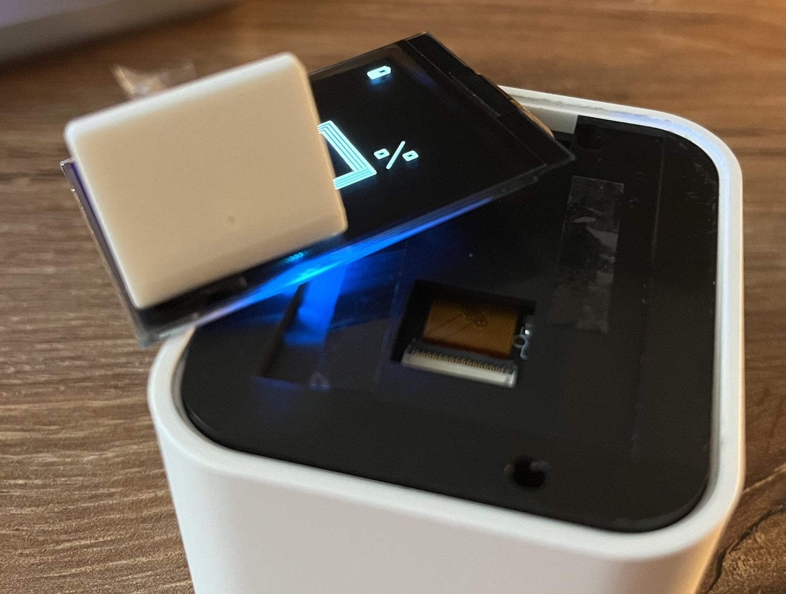

> **On my device:** the handle in the photos is a plastic bracket from a window blind, stuck to the
> panel with the same double-sided tape. Its short arm works as a lever, and I lifted the panel
> gently with it.

The glue stays on the panel and holds very hard. Soften it with an adhesive remover spray, wipe it
off, then clean the glass with alcohol wipes before you glue anything back.

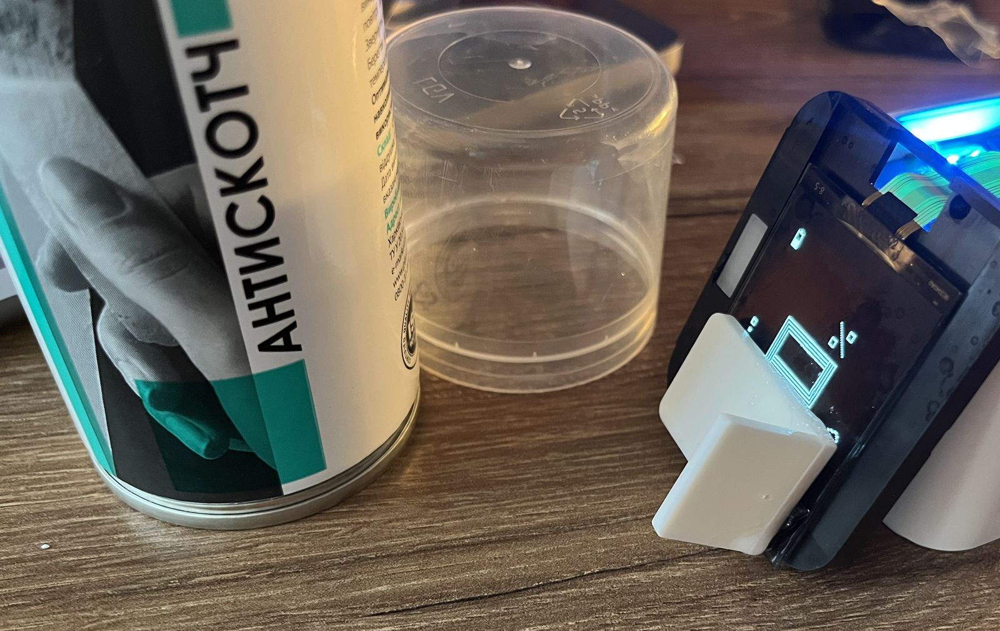

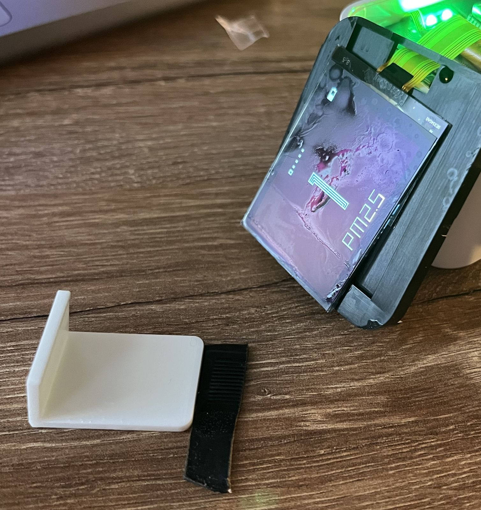

### The plate under the display

It is held by two screws. Take them out and fold the plate to the right with the panel on it. The
main board with the ESP32 module is under it; the board itself stays in the housing.

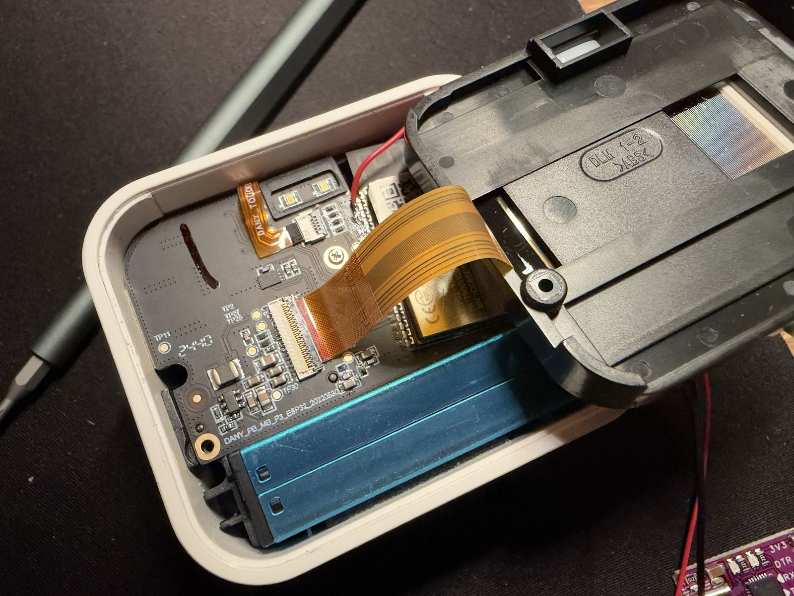

The pads can be reached with the main board in place, but I recommend lifting it out before you
solder: in the housing the pads sit right by the plastic edge, which melts (see step 2). Under the
board are the battery and the connectors to the rest of the device.

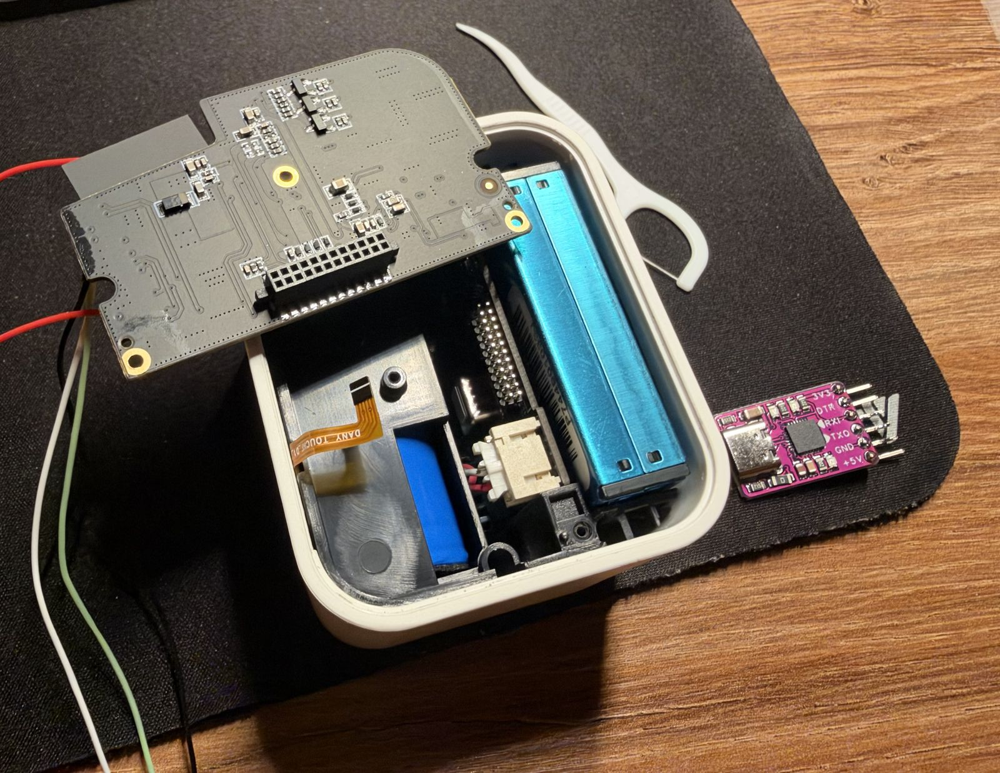

> **On my device:** I did lift the main board. Its top edge comes up easily, but along the bottom
> it sits on a connector to the board underneath, and that holds it. I levered it off that
> connector gently, a little at a time, with the plastic end of a dental floss pick, which you can
> see in some of the photos.

## 4. Find the pads

The pads are next to the ESP32 module. The letters are the names this guide uses for them.

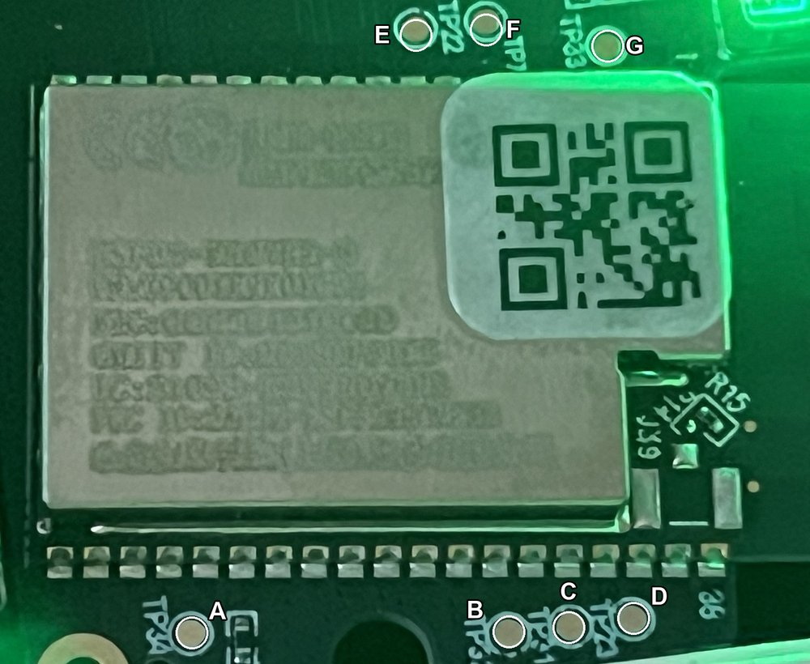

| Pad | What it is | Where |
|---|---|---|
| A | IO0, puts the chip into download mode | TP34, next to the gold mounting ring |
| B | ground | in a row with C and D |
| C | the chip's receive line | in a row with B and D |
| D | the chip's transmit line | in a row with B and C |
| G | EN, restarts the chip (optional) | TP33 |

B, C and D sit in a row, and their printed numbers are hard to read, so tell them apart with a
multimeter: B connects to the module's metal shield, C to module pin 34, D to pin 35. Module pins
and measurements are in [hardware.md](hardware.md#esp32-test-pads).

> **On my device:** nobody had published a pinout, so I found the pads myself with the module's
> datasheet and a multimeter, with the device off.

## 5. Solder the wires and connect the adapter


| Pad | Adapter pin |
|---|---|
| B, ground | GND |
| D, transmit | RXI |
| C, receive | TXO |
| A, IO0 | none: you touch it to ground by hand |
| G, EN (optional) | none: you touch it to ground by hand |

The adapter's 3V3 and +5V stay unconnected.

Soldering tips:

- Pads A, C, D and G take solder easily at about 320 °C.
- Pad B is joined to a large copper area that pulls the heat away. Add flux, raise the iron by 20 to
  30 °C (about 340 to 350 °C for leaded solder) and hold it a little longer.
- Keep the wires short, and leave no loose wire end that can touch the board.
- Then check with the multimeter that each wire connects to its pin and no two wires touch.

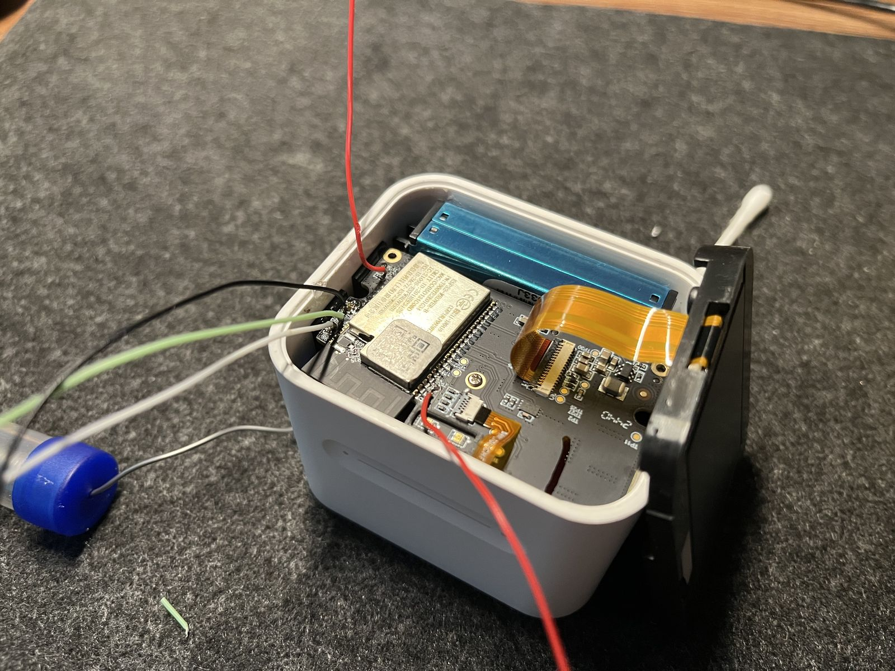

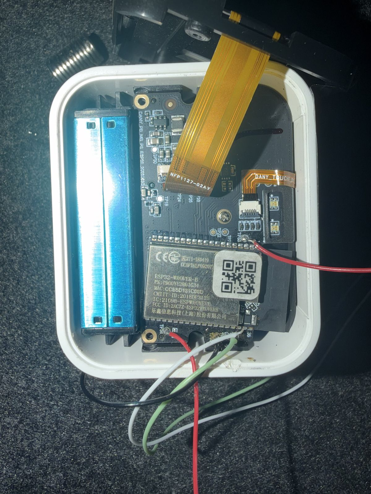

> **On my device:** I had no wires in different colours, so the first time I took the ones out of
> an old USB cable: black on B, white on D, green on C, and two red ones on A and G, as in the
> photos. I did not tag the red ones at first, and it cost me a failed attempt in step 6.
>
> Pad B would not take solder at the temperature that worked on the others, until I added flux and
> more heat. I soldered with the board still in the housing, and without noticing I melted the white
> plastic next to the pads in a few places with the iron's shaft. Next time I would take the board
> out first.
>
> Later I resoldered with four wires and no EN: green on A, black on B, white on C, red on D. At the
> adapter: red to RXI, white to TXO, black to GND.

## 6. Download mode

The chip has to be started in download mode before esptool can talk to it. The adapter cannot do
that by itself, so you do it by hand, with the device on USB-C power. Touching a wire to ground
means pressing its end against the module's metal shield.

**Without an EN wire:**

1. Hold the IO0 wire (pad A) against ground.
2. Turn the device off and on with the power button on the back.
3. Release IO0.

**With an EN wire:**

1. Hold the IO0 wire against ground.
2. Touch the EN wire to ground and take it away.
3. Release IO0 about a second later.

The chip now waits for esptool. If the screen stays dark and esptool still cannot connect, check
that you held IO0 and not EN: EN held on ground keeps the chip from starting.

> **On my device:** I first used the EN wire. My first attempt failed: the two red wires were not
> labelled, I held EN to ground instead of IO0, and the screen stayed dark. Later I found the power
> button does the same job, and dropped the EN wire. I did that with the stock firmware on the
> chip, and it came back in download mode. With this firmware the button does not cut the power on
> USB, so I have not tried it there.

## 7. Back up the stock firmware

Do not skip this step: the backup is the only copy of your device's HomeKit setup data and keys
(see the warning at the top). Make it before anything is written to the flash.

Find the adapter's serial port. On macOS my CP2102 appeared as `/dev/cu.usbserial-0001`; on Linux
look for `/dev/ttyUSB*`. Espressif's
[serial connection guide](https://docs.espressif.com/projects/esp-idf/en/v5.5.5/esp32/get-started/establish-serial-connection.html)
covers the other cases. In a shell with ESP-IDF activated (`. ~/esp/esp-idf/export.sh`), enter
download mode and run:

```bash
esptool.py --port /dev/cu.usbserial-0001 --baud 115200 --before no_reset chip_id
```

If it prints the chip's details, the connection works. Enter download mode again,
then read the whole 4 MB flash:

```bash
esptool.py --port /dev/cu.usbserial-0001 --baud 115200 --before no_reset read_flash 0 0x400000 cgdn1-stock.bin
```

It takes about six and a half minutes at 115200 baud. Do not go faster. If any command fails, enter
download mode again and repeat it. esptool checks every block it reads, and the file must be exactly
4194304 bytes:

```bash
ls -l cgdn1-stock.bin
```

Copy the file somewhere safe, off this computer, in two places, and keep it private.

> **On my device:** I tried faster speeds to save time. At 921600 the read broke off halfway and
> the chip would not answer until I entered download mode again; at 460800 it failed too. At 115200
> the backup took about six minutes and finished.

## 8. Build the firmware

```bash
git clone https://github.com/noxend/qingping-cgdn1.git
cd qingping-cgdn1
plugins/get-wasi-sdk.sh          # wasi-sdk into ~/.local, once
. ~/esp/esp-idf/export.sh        # activate ESP-IDF v5.5.5
cd firmware
idf.py secure-generate-signing-key secure_boot_signing_key.pem
idf.py build
```

`secure-generate-signing-key` makes the key every image is signed with; the build refuses to run
without it. The file is in `.gitignore`. Copy it somewhere safe right away: the device takes
updates only from images signed with this key.

Releases published on `cgdn1.swithy.com` are signed with the maintainer's key, so a device built
with your own key does not install them: it still shows them as a new version, and Update fails
when it checks the signature. Leave "Update automatically" off and update with your own builds
(see [Updating](using.md#updating)).

> **On my device:** I keep my key outside the repository folder, in `~/.config/cgdn1/`, so it cannot
> end up in git by accident.

## 9. Flash it

Keep the device on USB-C power, enter download mode (step 6), then from `firmware/`:

```bash
idf.py -p /dev/cu.usbserial-0001 -b 115200 flash monitor
```

This writes everything, the bootloader included. The bootloader never changes over Wi-Fi, and it is
what rolls back a bad update later, so this first flash matters.

When the flash is done, restart the chip with IO0 free: touch EN to ground. Without an EN wire, try
turning the device off and on with the power button; I have not tested that right after a flash.
`idf.py monitor` shows the boot log; leave it with `Ctrl+]`.

On the first start the device generates its own setup password and installs the standard screens.
With no Wi-Fi saved, the screen shows a QR code for the setup access point `CGDN1-setup-XXXX`,
with its name under it. Slide on the strip to see the name, the password after `Pass` and the
address `http://10.47.0.1/` as text.

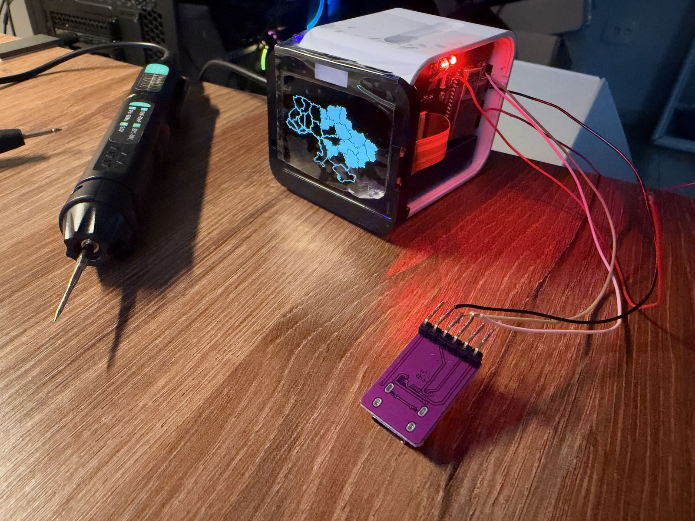

> **On my device:** the first firmware I flashed over the wires did almost nothing on purpose: Wi-Fi
> setup, updates over Wi-Fi and the automatic rollback. I wanted updates to work before anything
> else, so I could close the case and do the rest over Wi-Fi.

## 10. Connect it to Wi-Fi

1. Scan the QR code on the screen with a phone camera and join the network it offers. On a laptop,
   join `CGDN1-setup-XXXX` with the password from the text page. Most phones open the setup page by
   themselves; otherwise open `http://10.47.0.1/`.
2. Choose a device password: 8 to 63 characters, letters, digits or symbols, no spaces. You sign in
   to the web interface with it, and only a factory reset clears it. Write it down.
3. Pick your home network and type its password.
4. Save. The device restarts and joins your network. The page and the device screen show the
   address to open next: `http://cgdn1.local/` and the IP address.

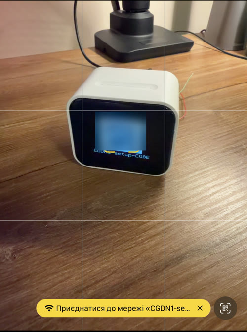
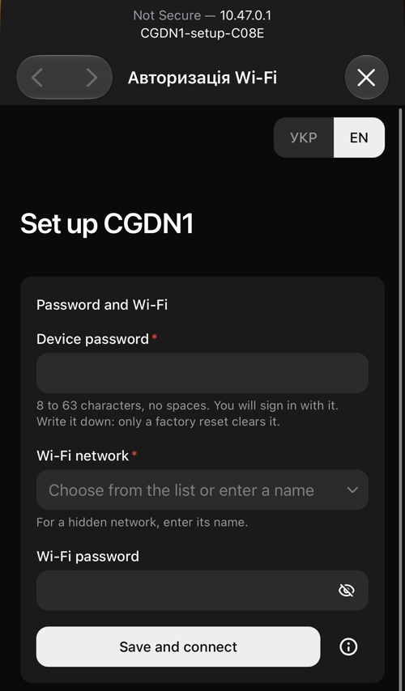

Phones and laptops older than about ten years may not be able to join the setup network.

The rest, the screens, the menu and the web interface, is in [using.md](using.md).

## 11. Close the case

Before you glue the glass back, try one update over Wi-Fi while the wires are still reachable:
build again, then on the System page of the web interface use "Install from file" with
`firmware/build/cgdn1.bin`. The device restarts into it, and if the new version runs fine for a
minute, it stays.

Then decide about the wires:

- If you keep them, keep them short and check that no bare end can touch the board when the case is
  closed. An EN wire is the one that can restart a frozen device from outside; without it, a frozen
  build means opening the case again. If you keep it, keep it short and its end insulated.
- One way to keep them reachable, shown here: route them out through the back grille, next to the
  USB-C socket.

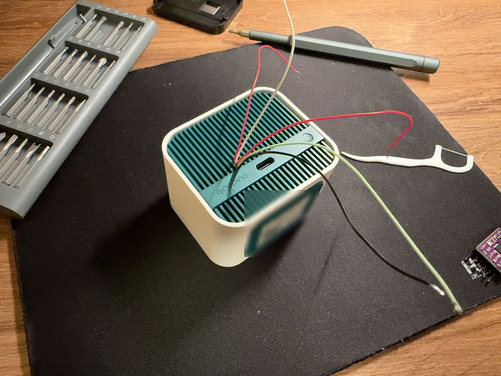

Put the plate back with its two screws, fold the panel back, and press the front glass down: the
old adhesive holds it. New thin double-sided tape is optional.

> **On my device:** keeping the wires paid off once. On 2026-10-20 a new build froze about two
> minutes after start, and a long press of the power button did nothing. A tap of EN to ground over
> those wires brought it back.
>
> They also caused trouble. With the wires left soldered and dangling inside the case, the device
> stopped responding and restarted by itself, even on the stock firmware. After I removed the EN
> wire and put the case back together carefully, it runs normally. I do not know which of the two
> fixed it, so: short wires, no loose EN wire, and a look at what touches what before you close it.

## 12. When something goes wrong

**esptool cannot connect.** Check, in this order: the device is on USB-C power; TX and RX are
crossed (pad D to the adapter's RXI, pad C to TXO); GND is connected; you entered download mode
right before the command; the baud rate is 115200.

**The screen went dark and stays dark.** The chip is either in download mode or not starting. Free
IO0 and EN, then restart it: touch EN to ground. Without an EN wire, try turning the device off and
on with the power button (not tested in every state). If it is still dark, check that EN is not
shorted to ground.

**An update over Wi-Fi does not start properly.** If a new version does not start properly or keeps
crashing, the device goes back to the previous one by itself, and the System page says so.

**The device cannot reach your Wi-Fi.** Its setup access point comes back whenever the home
network is lost. Hold the power button for a second, choose Wi-Fi setup, and the screen shows the
QR code again.

**You forgot the device password.** On the device: hold the power button for a second, slide to
Factory reset, tap, slide to "Yes, reset", tap. Settings, Wi-Fi and the password are erased; the
firmware stays.
Then set it up again from step 10.

**You lost the signing key.** Generate a new one, build, and flash over the pads again (step 9).
The device then takes only images signed with the new key.

**Back to the stock firmware.** Write the whole backup over the pads, in download mode:

```bash
esptool.py --chip esp32 --port /dev/cu.usbserial-0001 --baud 115200 --before no_reset --after no_reset write_flash 0 cgdn1-stock.bin
```

This restores everything the backup holds, the HomeKit data and keys included. On my device it took
about four minutes at 115200 and esptool reported the data verified. Then restart the chip as at
the end of step 9; the stock firmware started and ran again. To come back to this firmware
afterwards, flash it again as in step 9.
