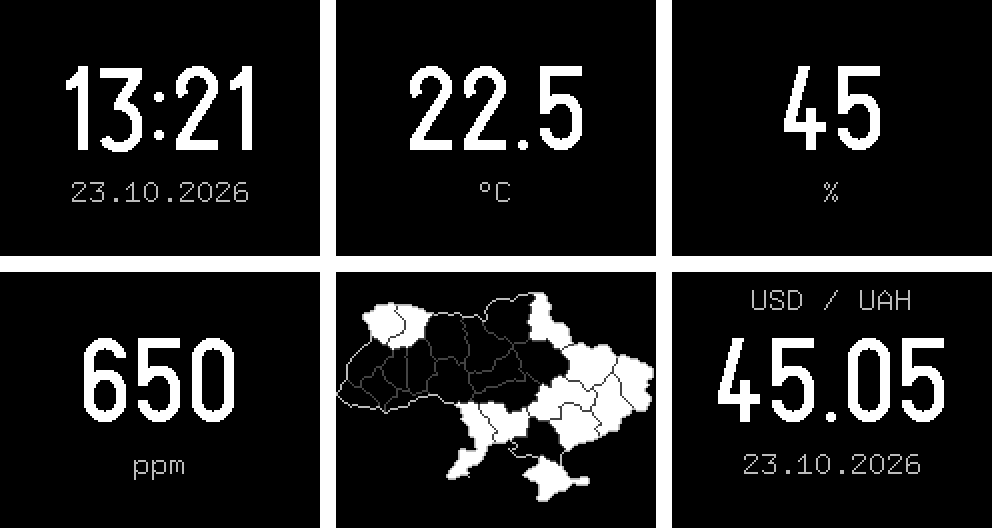
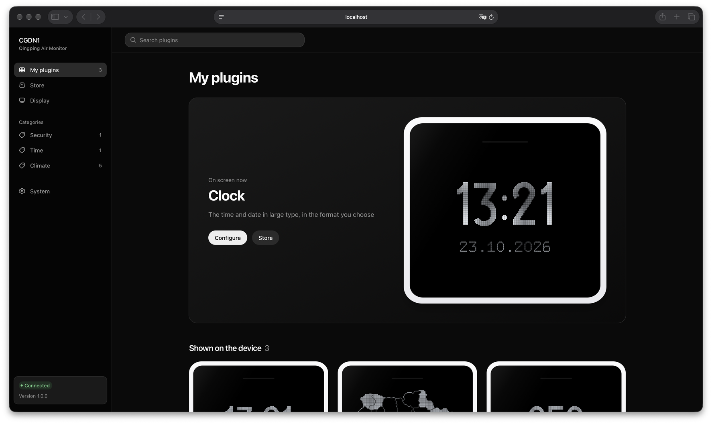
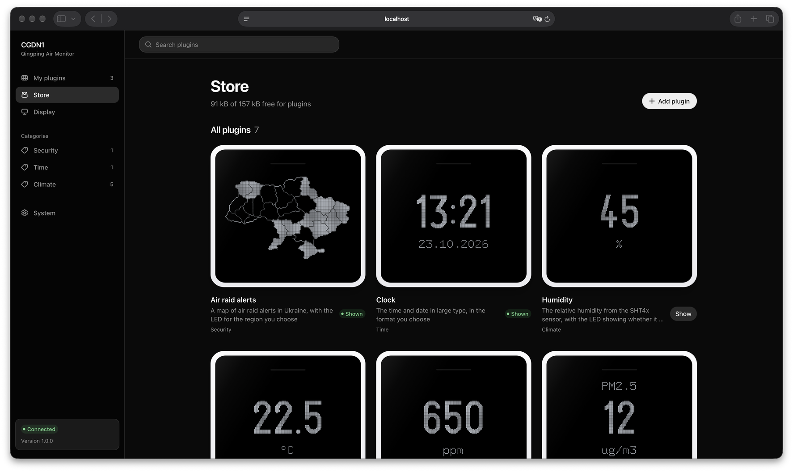
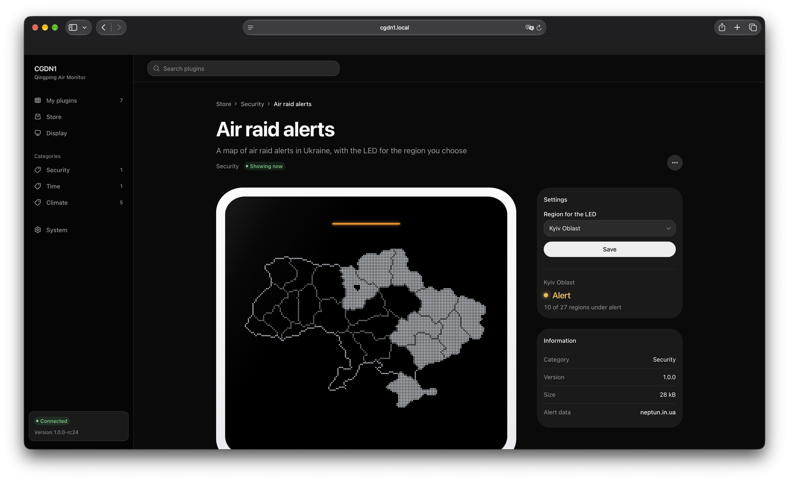
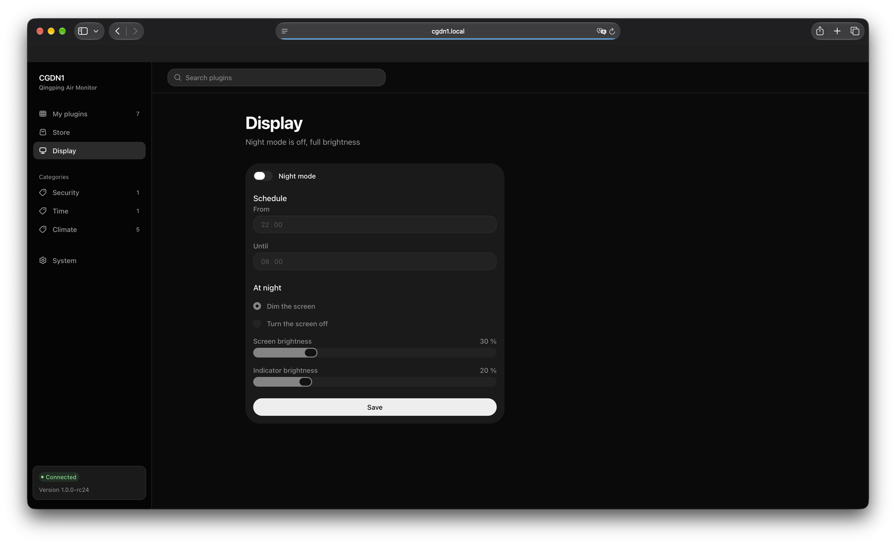
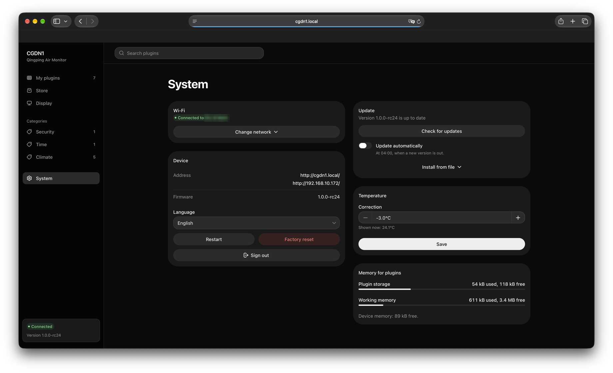

# Using the device

How the CGDN1 works once the custom firmware is on it. Installing it is in
[install.md](install.md).

## On the device

### Screens

Each screen is a plugin. The ones that come with the firmware:

| Screen | Shows | Indicator LED |
|---|---|---|
| [Clock](../plugins/standard/clock/README.md) | time and date | off |
| [Temperature](../plugins/standard/temperature/README.md) | °C or °F, one decimal | off |
| [Humidity](../plugins/standard/humidity/README.md) | relative humidity, % | green, amber or red for comfort |
| [CO2](../plugins/standard/co2/README.md) | ppm | green, amber or red at levels you set |
| [Air raid alerts](../plugins/standard/alerts/README.md) | map of Ukraine's regions under alert | red or amber for the region you pick |

The last frame is the [NBU exchange rate](../plugins/examples/nbu/README.md) example, which you
install yourself.

### The touch strip

- **Slide** a finger along the strip: the next screen.

In the menu the strip moves and chooses: sliding right moves down the list, sliding left moves up,
and a tap chooses.

### The power button

The button on the back:

- **Short press**: turns the screen and the indicator off, or back on. A touch on the strip also
  turns them back on. In the menu a short press goes back one page, and from the list it closes
  the menu.
- **Hold for 1 second**: the menu opens.
- **Hold for 5 seconds**: the screen shows "Powering off" and the device powers off when you let
  go, whatever the menu is doing. Hold the button for 2 seconds to power it on again; the screen
  shows "Starting" until the first screen is ready.
- **On USB power** the device cannot cut its own power: after a power off it stays dark and ignores
  the strip and short presses until the next 1 second hold, which starts it again.

In the first minute after a firmware update, power off does nothing, from the button or the menu,
until the new version has confirmed itself.

### The menu

The menu closes by itself after 30 seconds without a touch. Its rows:

- **Power off**: the same as the 5 second hold.
- **Restart**.
- **Wi-Fi setup**: a QR code for the setup access point, with its name under it. Scan it with a
  phone camera to join. Slide to see the name, password and address as text; tap to go back. If
  the device is online it asks "Start hotspot?" first; Yes brings the access point up for 10
  minutes.
- **Factory reset**: asks again; slide to "Yes, reset" and tap. "No" goes back.
- **Info**: firmware version, IP address, Wi-Fi network, uptime, and Back.
- **Back**: closes the menu.

The menu is in English only.

### Night mode and burn-in protection

Night mode dims the screen and the indicator, or turns the screen off, between two times you set on
the Display page. It is off by default; when turned on it runs from 22:00 to 08:00 with the screen
at 30 % and the indicator at 20 %.

Burn-in protection is always on: the picture moves by a pixel every minute, so static parts of a
screen do not wear into the OLED panel.

## The web interface

On the same Wi-Fi network, open `http://cgdn1.local/`. If that name does not open (some Android
browsers, some routers), use the IP address from Info in the device menu. The device answers only
to `cgdn1.local` and its IP address, not to a name your router made up for it. If another device
on the network already uses the name, it becomes `cgdn1-2.local`.

The first page asks for the device password you chose at setup. The browser stays signed in through
restarts and updates until it has not opened the interface for 30 days. `cgdn1.local` and the IP
address are separate sites to the browser, so each needs its own sign-in. The interface is in
English and Ukrainian: pick one under System, Device, Language, or with УКР / EN on the sign-in
page.

The interface loads its files from `https://cgdn1.swithy.com`. The device accepts only a list of
those files signed with the project's key, and the browser checks every file against it. Without
internet access the device serves a copy built into the firmware, which can do the same things but
may be older.

### My plugins and the store

**My plugins** lists the screens shown on the device, with a live preview of each. **Store** lists
every plugin the device has, shown or not. "Show" adds one to the screens.

A plugin's page has its settings, "Show now" to put it on the screen at once, and, under the "⋯"
button, "Stop showing" and "Delete from device". A deleted standard plugin stays in the store and
installs again from the firmware.

**Add plugin** in the store installs your own plugin from a `.wasm` file. How to write one is in
[plugins/README.md](../plugins/README.md).

### Display

Night mode: on or off, the schedule, dim or turn off the screen, and the two brightness levels.

### System

- **Wi-Fi**: the network the device is on; "Change network" picks another one without the setup
  access point.
- **Device**: its addresses and firmware version, Restart, Factory reset, Sign out.
- **Update**: see below.
- **Memory for plugins**: how much plugin storage and working memory is used and free.
- **Temperature**: a correction of -3.0 to +3.0 °C added to the measured temperature, for a device
  that reads warmer or cooler than a thermometer you trust. The panel, the plugins and the web
  interface all show the corrected value. Humidity is recalculated for the corrected temperature,
  since air that reads warmer than it is also reads drier.

## Updating

The device checks for a new release every hour. When there is one, the header shows "New version",
and the Update card on the System page shows what changed. Update downloads and installs it, and the
device restarts. "Check for updates" asks at once. "Update automatically" installs new releases at
04:00; it is off by default.

"Install from file" takes a `.bin` you built yourself (`firmware/build/cgdn1.bin`).

Every image must be signed with the key the device was built with, and the new version has to stay
healthy for its first minute. If it does not, the device goes back to the version it had, and the
System page says so. A release that rolled back on this device is skipped by the automatic update;
Update still installs it by hand.

Releases on `cgdn1.swithy.com` are signed with the maintainer's key. A device you built with your
own key still shows them as a new version, but Update fails when it checks the signature. Leave
"Update automatically" off on such a device and install your own builds through "Install from
file".

## Restart and factory reset

Restart and Factory reset are on the System page, and Factory reset is also in the device menu.
A factory reset erases the saved Wi-Fi network, the device password, every setting and every
signed-in browser and the plugins you uploaded. It keeps the firmware, installs the standard
plugins again, and restarts into the setup access point with a new password, as on the first start. Then set it up as in
[install.md, step 10](install.md#10-connect-it-to-wi-fi).

## Wi-Fi

With no home network saved, or whenever the saved one is lost, the device runs its setup access
point `CGDN1-setup-XXXX` at `http://10.47.0.1/`. It turns off 5 minutes after the device joins
your network. The access point needs a client with protected management frames (PMF); phones and
laptops from the last ten years have it.

## What it does not do

- No smart home connection yet: no Apple Home (HomeKit), no Home Assistant, no Qingping or Mi Home
  app. HomeKit support is planned to be looked at later; if it does not work out, the fallback is
  an API for Home Assistant.
- No PM2.5 or PM10: the particle sensor is not read.
- No battery level and no charging screen: the charge controller's protocol is not decoded yet.
- The time zone is fixed to Kyiv.
- The device password can be changed only by a factory reset and a new setup.
- `cgdn1.local` needs multicast DNS; on networks that block it, use the IP address.
- The password and the session cookie travel over plain HTTP on your local network.

## Data sources and credits

- Air raid alerts: [NEPTUN](https://neptun.in.ua) (`neptun.in.ua`), free and keyless. NEPTUN is an
  aggregator, not an official warning system: do not rely on this screen alone. Its one condition
  is this visible credit.
- Region boundaries: [geoBoundaries](https://www.geoboundaries.org) UKR ADM1 (OpenStreetMap,
  ODbL) clipped to the [Natural Earth](https://www.naturalearthdata.com) 50m coastline (public
  domain).
- Exchange rates in the example plugin: the National Bank of Ukraine (`bank.gov.ua`).
