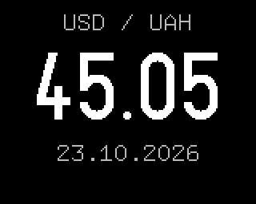

# NBU exchange rate

Plugin id `nbu_rate`. The National Bank of Ukraine's official rate of the hryvnia to one currency,
with the date it is set for. An example of a plugin that uses the network; the device does not come
with it.



## Install

```bash
cd plugins
./build.sh examples/nbu
```

Then upload `examples/nbu/nbu.wasm` in the web interface: Store, Add plugin, Choose file.
`./preview.sh examples/nbu` builds it and shows its frames on your computer first.

## Settings

| Setting | Values | Default |
|---|---|---|
| Currency | USD, EUR, PLN, GBP, CHF, CZK | USD |

## Data

`https://bank.gov.ua/NBUStatService/v1/statdirectory/exchange?valcode=<code>&json`, asked when the
screen is shown and the rate is older than 30 minutes, then every 30 minutes while it stays shown.
A rate on screen stays while a new request is out; a failed answer shows `--` and "no data".

## What to read in the code

The request and its answer (`core_net_get`, `net_buffer`, `on_net`), reading JSON with the SDK's
`json_` calls, a number printed without `%f`, and a second request wanted while the first is still
out.
