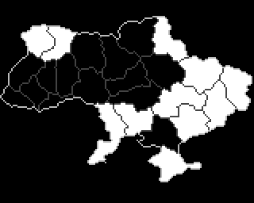

# Air raid alerts

Plugin id `alerts`. A map of Ukraine's 27 regions: those under an air raid alert are filled, the
borders between regions thin and dim, the country's outline brighter. A border looks the same
whichever of its two sides is under alert. The LED shows the alert in the region you choose.

## Settings

| Setting | Values | Default |
|---|---|---|
| Region for the LED | any of the 24 oblasts, Crimea, Kyiv or Sevastopol | Kyiv Oblast |

## Data

[NEPTUN](https://neptun.in.ua) (`https://neptun.in.ua/api/v1/alerts`), free and keyless, asked every
30 seconds while the map is shown. An alert for a whole oblast or for any of its districts marks
the oblast. Without an answer to show the map has a dim outline and a note: "loading" while the
first request is out, "no data" when it failed or after about five minutes of failed requests
(offline counts), rather than alerts that may be over.

NEPTUN is an aggregator, not an official warning system. Do not rely on this screen alone. Its one
condition is a visible credit: data © neptun.in.ua.

## LED

| Alert in the chosen region | LED |
|---|---|
| red level | red |
| yellow level | amber |
| none | off |

The plugin's help in the web interface describes red as missiles and ballistic threats and yellow
as Shahed and other drones. The map itself is grey and does not tell the two apart.

## Files

- `map.bin`: the map, one byte per pixel: the region's index, or a border, the outline or
  outside. Borders belong to neither region.
- `gen_alert_map.py` makes `map.bin` from [geoBoundaries](https://www.geoboundaries.org) UKR ADM1
  (data © OpenStreetMap contributors, [ODbL](https://www.openstreetmap.org/copyright), so
  `map.bin` is under the ODbL too) clipped to the [Natural Earth](https://www.naturalearthdata.com) 50m
  coastline (public domain): the regions simplified together so shared borders stay shared,
  slivers and stray pixels merged, every line one pixel wide. Run it with
  `uv run plugins/standard/alerts/gen_alert_map.py <adm1.geojson> <ne_50m_land.geojson>`.

## Stats

`GET /plugin/stats?id=alerts` on the device gives the fetch counters, the last HTTP status, the
number of regions under alert, and the chosen region with its level.

## Credits

Air raid alert data: [neptun.in.ua](https://neptun.in.ua). Region boundaries:
[geoBoundaries](https://www.geoboundaries.org) and [Natural Earth](https://www.naturalearthdata.com).

`map.bin` contains data © OpenStreetMap contributors, available under the
[Open Database License](https://www.openstreetmap.org/copyright).
