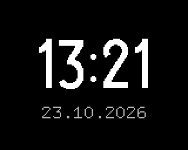

# Clock

Plugin id `clock`. The time in large digits and the date under it.

## Settings

| Setting | Values | Default |
|---|---|---|
| Time format | 24-hour, 12-hour (AM/PM) | 24-hour |
| Date format | DD.MM.YYYY, YYYY-MM-DD, MM/DD/YYYY | DD.MM.YYYY |
| Show seconds | on, off | off |

In 12-hour format AM or PM shows above the time. With seconds on, they follow the minutes in
smaller digits: the large ones would not fit across the panel.

## Where the time comes from

The firmware sets the clock over the internet (SNTP, `pool.ntp.org`) and keeps it running offline.
The plugin only formats the device's local time. Until the clock has been set after a start, the
screen shows `--` and "time not set".

## Limits

- The time zone is fixed to Kyiv by the firmware, not by this plugin.
- No LED.
- The screen redraws once a second while it is shown, and only when the text changed.
