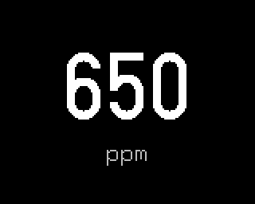

# CO2

Plugin id `co2`. The carbon dioxide level from the device's Sensirion SCD40 sensor, in ppm, with the
LED as a traffic light.

## Settings

| Setting | Meaning | Default |
|---|---|---|
| Amber from, ppm | the LED turns amber at this level | 800 |
| Red from, ppm | the LED turns red at this level | 1200 |

A red level at or below the amber one is moved to one above it.

## Data

The SCD40 gives a new value every 5 seconds; the screen checks it at that pace while it is shown.
With no valid reading the screen shows `--`.

## LED

| CO2 | LED |
|---|---|
| below the amber level | green |
| from amber up to the red level | amber |
| at or above the red level | red |
| no reading | off |

Fresh outdoor air is about 400 ppm; above 1000 to 1200 ppm people tend to notice stuffiness.
