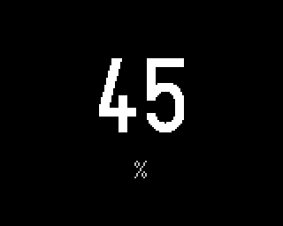

# Humidity

Plugin id `humidity`. The relative humidity from the device's SHT4x sensor, in whole percent, in
large digits with `%` under them.

## Settings

None.

## Data

The SHT4x reading, checked every 2 seconds while the screen is shown. With no valid reading the
screen shows `--`.

## LED

| Humidity | LED |
|---|---|
| 40 to 60 % | green |
| 30 to 40 % or 60 to 70 % | amber |
| below 30 % or above 70 % | red |
| no reading | off |
