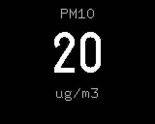

# PM10

Plugin id `pm10`. Coarse particles (PM10) from the device's Plantower particulate sensor, in whole
µg/m³, in large digits under a `PM10` caption. The label reads `ug/m3`: the panel's text font has
no µ or ³.

## Settings

None.

## Data

The firmware reads the sensor once a second, as the stock firmware does, and shows the value the
stock would. A sensor whose frames carry version 0x80 is shown as measured. For any other: as
measured while PM2.5 is up to 61, above that the stock's correction, 999 when PM2.5 is above 592,
and both values 0 when either is 0. Past about 1840 µg/m³ the stock's curve turns negative and it
shows 0; this screen shows 999. The first two readings after power on are skipped. The screen
checks the value every second while it is shown; with no valid reading it shows `--`.

## LED

The stock firmware's levels and colours:

| PM10, µg/m³ | LED |
|---|---|
| up to 50 | green |
| 51 to 150 | yellow |
| 151 to 250 | orange |
| 251 to 350 | red |
| 351 to 450 | purple |
| above 450 | dark red |
| no reading | off |
