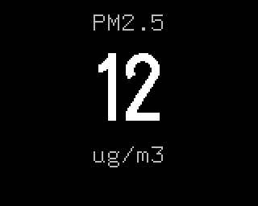

# PM2.5

Plugin id `pm25`. Fine particles (PM2.5) from the device's Plantower particulate sensor, in whole
µg/m³, in large digits under a `PM2.5` caption. The label reads `ug/m3`: the panel's text font has
no µ or ³.

## Settings

None.

## Data

The firmware reads the sensor once a second, as the stock firmware does, and shows the value the
stock would. A sensor whose frames carry version 0x80 is shown as measured. For any other: up to
61 as measured, above that the stock's correction, 999 above 592, and both values 0 when either
is 0. The first two readings after power on are skipped. The screen checks the value every
second while it is shown; with no valid reading it shows `--`.

## LED

The stock firmware's levels and colours:

| PM2.5, µg/m³ | LED |
|---|---|
| up to 35 | green |
| 36 to 75 | yellow |
| 76 to 115 | orange |
| 116 to 150 | red |
| 151 to 250 | purple |
| above 250 | dark red |
| no reading | off |
