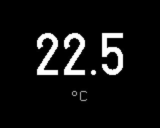

# Temperature

Plugin id `temperature`. The air temperature from the device's SHT4x sensor, with one decimal.

## Settings

| Setting | Values | Default |
|---|---|---|
| Unit | °C, °F | °C |

## Data

The SHT4x reading, checked every 2 seconds while the screen is shown. With no valid reading (right
after a start, or a sensor that stopped answering) the screen shows `--`.

## Limits

- No LED: the indicator is off while this screen is shown.
